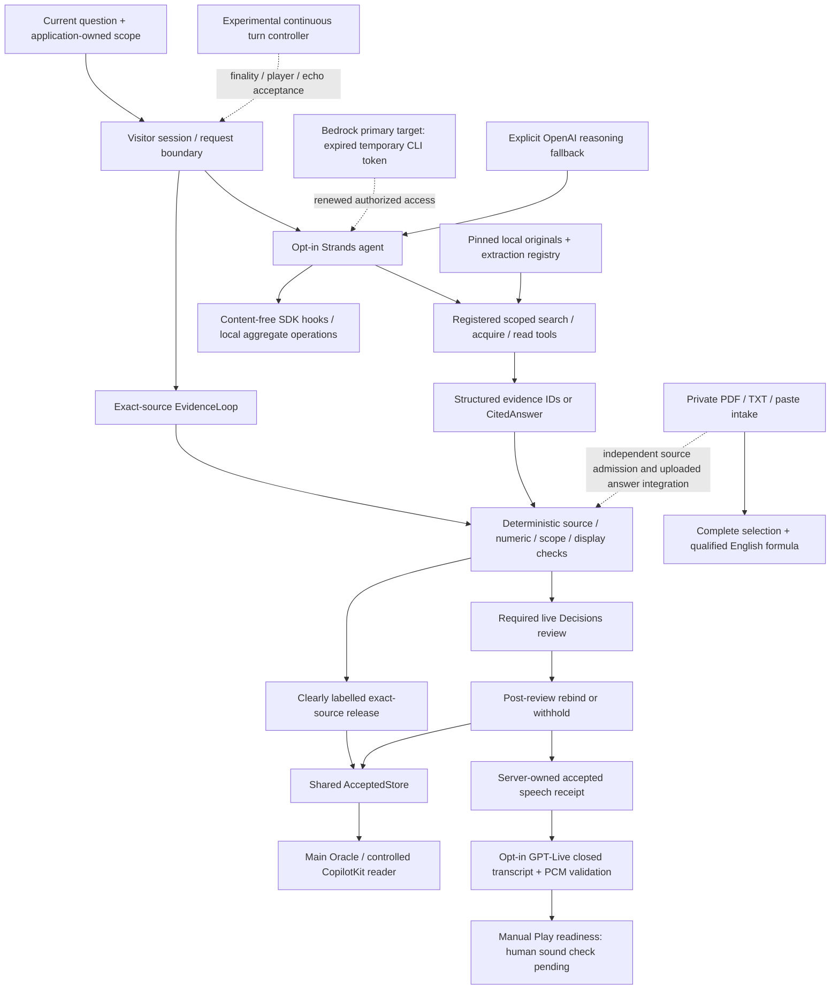
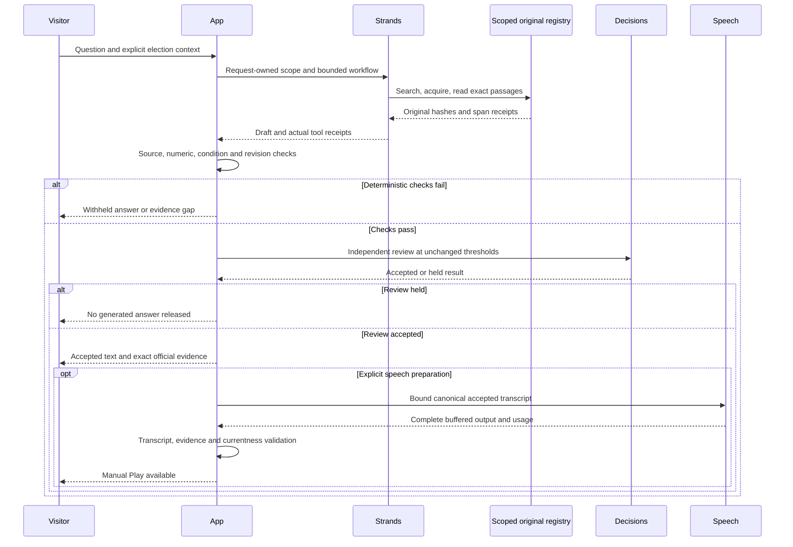
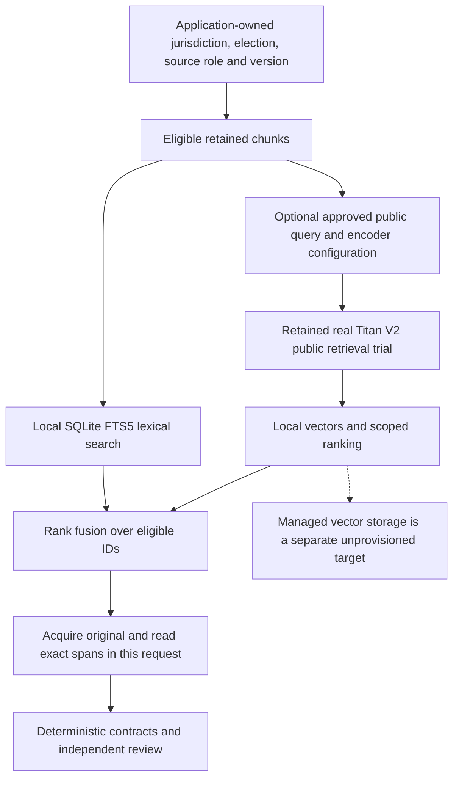

<picture>
  <source media="(prefers-color-scheme: dark)" srcset="brand/lockups/horizontal/open-oracle-horizontal-serif-reversed.svg">
  
</picture>

# Open Oracle

**Your ballot. Explained your way.**

You can read every word on a ballot and still not know what a Yes vote would do. Open Oracle helps you work through that choice: ask what a proposal means, get a focused explanation and open the exact source behind it. Starting with Kansas City’s November ballot, it explains key terms and conditions and keeps candidate answers attributed to their authors.

**Built to explain, not to campaign.** No ads. No paid placement. No advice on how to vote.

Built for **Hack Midwest with AWS Strands Agents SDK**. Strands does the evidence work: resolve the question, find applicable sources, read exact passages and return structured evidence. The application checks that evidence before an answer reaches the screen or speaker. In a real Amendment 7 trial, the No explanation passed review; the Yes explanation was held. Withholding an unsupported answer is part of the product.

**[Try the working demo](#try-the-working-demo)** · **[See the Strands workflow](#how-strands-drives-the-evidence-loop)** · **[Reproduce it locally](#setup-and-local-routes)**

## Judge’s guide

| Start here | What to inspect |
|---|---|
| **Use the demo** | [Retained-source walkthrough](#try-the-working-demo): Amendment 7 Yes/No, exact sources and Erase. The default needs no API key or model call. It does require the pinned source archive. |
| **See the agent work** | [Strands evidence loop](#how-strands-drives-the-evidence-loop): registered tools, scoped reads, structured output, hooks and bounded context completion. [Selector code](open_oracle/orchestration.py) and [research agent](strands_quality/research_agent.py). |
| **Follow a real trial** | [Five-source live receipt](docs/public-evidence-summary.md#five-source-live-proof): actual Strands and independent review; No accepted, Yes held. Scores are not accuracy percentages. |
| **Understand the AWS boundary** | [Provider and AWS status](#provider-roles-and-aws-status): historical Bedrock reasoning, bounded Titan V2 retrieval proof, local observability and explicit unprovisioned services. |
| **Reproduce the checks** | [Setup](#setup-and-local-routes), [evaluation commands](#evaluation-and-reproducibility) and [architecture](#architecture-and-trust-boundaries). Authored tests, actual provider runs and human/device acceptance are separate proof sets. |

## Contents

- [Try the working demo](#try-the-working-demo)
- [Two product experiences](#two-product-experiences)
- [Architecture and trust boundaries](#architecture-and-trust-boundaries)
- [Verified integration matrix](#verified-integration-matrix)
- [How Strands drives the evidence loop](#how-strands-drives-the-evidence-loop)
- [Provenance, review and release](#provenance-review-and-release)
- [Provider roles and AWS status](#provider-roles-and-aws-status)
- [Usability, accessibility and language](#usability-accessibility-and-language)
- [Sessions, cancellation and privacy](#sessions-cancellation-and-privacy)
- [Evaluation and reproducibility](#evaluation-and-reproducibility)
- [Setup and local routes](#setup-and-local-routes)
- [Known limits and next gates](#known-limits-and-next-gates)
- [Assets and licensing](#assets-and-licensing)

## Try the working demo

With the pinned source archive and dependencies available, start the local server:

```sh
.venv/bin/python -B -m open_oracle.server --host 127.0.0.1 --port 8765
```

Open <http://127.0.0.1:8765/>. Reuse an already running instance; do not start a duplicate listener.

1. Choose **Understand Amendment 7**. This selects the retained Kansas City sample and its election context. Ask **“If I vote Yes, do my taxes go away?”** Then ask **“What does No mean?”** The retained-source explanation distinguishes the proposed fund and conditions from an immediate tax change. It offers no guaranteed tax-end date or personal savings.
2. Open the source wording and retained proposal PDF. Inspect the complete conditions, including net earnings, legislative approval and timing. The **3%** figure is a spending limit on the fund, not a new tax rate.
3. Try **“What is the COMBAT tax rate and how long would it last?”** Inspect the printed rate and ten-year duration, then ask **“What does No mean?”** Missing consequences remain explicit gaps.
4. Optionally compare **Pollard and Fields priorities**. Each candidate's retained answer stays attributed to that candidate and the same question. The prepared publisher archive is required for this path.
5. Open **Sources and limits**, then **Erase this session / Start again** and ask a fresh question. Erase clears local visitor state and rejects late results.

The default is **exact-source mode**: finite prepared explanations, deterministic source checks, independent AI review explicitly **not run**, voice **off**. It is a usable reading path when inference is unavailable; it is not described as live AI. The alternate controlled reader is <http://127.0.0.1:8765/copilot>. See the [Amendment 7 checkpoint](docs/public-evidence-summary.md#retained-source-browser) and [current source-reading contract](docs/accepted-reading-ingress.md).

The separate experimental live rehearsal at port **8772** is owner-controlled and capped. Its existence and past success do not guarantee another release; each new response is checked again. It is not the default judge startup. No recorded video URL or public deployment is asserted here.

Private supplied-document exploration is available on the separate untunneled Mac runtime at <http://127.0.0.1:18781/website>. Upload PDF or UTF-8 TXT, or paste wording; choose and inspect a complete block, confirm completeness, then explicitly choose the English formula if appropriate. No choice or unsupported wording produces no score. The source stays unverified and its language unknown; the formula does not approve meaning or comprehension. Cancel clears the preview while preserving input; Erase also clears the input and rotates the session.

To reproduce on an unused **untunneled loopback** port, run `.venv/bin/python -B -m open_oracle.server --host 127.0.0.1 --port 18781 --operations --intake`. Reuse the running instance when present. Do not enable private intake on an existing forwarded/tunneled listener; the current8765 Pi forward is preserved. [Private API and ownership contract](docs/private-intake-api.md) and [safe browser proof](docs/public-evidence-summary.md#private-intake) distinguish this working diagnostic from pending uploaded AI explanations.

## Two product experiences

| Experience | Purpose | Current boundary |
|---|---|---|
| **Public responsive landing / web tool** | Explain the project, show a useful sample, and let people supply PDF/TXT or pasted ballot wording for readability exploration. Desktop, iPad and mobile. | Private Mac-only PDF/TXT/paste, complete selection and explicitly chosen English formula estimates work at18781/website. Source and language remain unverified; uploaded AI explanations and public hosting are not enabled. |
| **Oracle live explanation** | A voice-first living ballot: one focal passage with a checked explanation, sources, follow-ups and distinct Stop/Resume/Erase. | Optimize kiosk presentation for a **16:9 TV at viewing distance**, while developing/demoing on **MacBook**. Desktop/browser is a presentation mode of this same Oracle, not a third product. Typed reading works; live speech readiness is narrower than continuous conversation. |

Both share evidence, release and session contracts. A file selected on the website does not silently become official kiosk evidence or transfer to another device. Claude leads presentation implementation for both experiences; core owns backend, release and runtime integration. The private ChatGPT Site, local runtime and isolated visual previews are separate deployments. The private Site's last checked snapshot was an older static introduction, not this working application.

## Architecture and trust boundaries

Solid arrows show implemented paths, including explicitly opt-in private paths. Dashed arrows show staged product activation or a future provider promotion. This is a local application; the diagram does not claim AWS hosting.



The input is untrusted data, not authority. Scope, source roles and versions come from the application. Retrieved prose cannot redefine tools or approve itself. Raw model reasoning, drafts and tool arguments do not enter the renderer. Readiness for display is separate from readiness for speech.

### Review sequence and scoped retrieval

The diagrams below describe separate opt-in research paths. The default typed
reader uses retained exact-source text; it does not run independent model review.
Human microphone/audibility acceptance is separate from the retained No buffer
proof. See the [source admission checkpoint](docs/source-admission-checkpoint-2026-10-11.md)
and [scoped accessibility audit](docs/kiosk-accessibility-checkpoint-2026-10-11.md).





Ranking is evidence discovery, not legal entailment or release approval. The
SOS and full printed-2018 Chapter 93 imports are opt-in private indices with
explicit roles and holds; default reader behavior and public source scope remain
unchanged. The managed guardrail adapter is imported but disabled and has no
actual AWS runtime/resource acceptance.

## Verified integration matrix

Evidence describes the linked checkpoint, not every later build. “Offline” means authored fixtures or synthetic model events; it is not provider inference.

| Feature | User benefit | Actual code path | Evidence / current status |
|---|---|---|---|
| Strands evidence selection | Reads applicable originals before choosing evidence for the answer | [orchestration.py](open_oracle/orchestration.py), `select_with_strands`, `Selection` | Real Nova workflows historically; current OpenAI Amendment 7 proof below. `resolve_contest → search_evidence → read_evidence`, with five-source Amendment batch tool. Opt-in only. |
| Strands research planning | Decomposes a supported compound question and exposes gaps | [research_agent.py](strands_quality/research_agent.py), `ResearchRequest`; [research_engine.py](open_oracle/research_engine.py) | [Real browser research](docs/browser-research-checkpoint-2026-10-11.md): COMBAT rate/duration and prediction refusal. Finite reviewed public grammar; arbitrary legal research not released. |
| Scoped retrieval and provenance | A citation points to the correct election, authority and exact passage | [research_corpus.py](strands_quality/research_corpus.py), `Registry`; [corpus.py](open_oracle/corpus.py) | Original/extraction/chunk hashes, page and code-point spans rechecked. [Source tests](tests/test_research.py) and [release tests](tests/test_research_release.py). Local FTS5/BM25 default. |
| Optional Titan V2 retrieval | Finds a public paraphrase that lexical search misses | [semantic_retrieval.py](strands_quality/semantic_retrieval.py) | [Actual AWS proof](docs/public-evidence-summary.md#titan-retrieval): one paraphrase over two spans, local cosine, wrong-scope controls excluded. Separate targeted HTTP trial ranked correctly but was held. Not full-corpus search quality. |
| Same-agent context completion | A missing fact can trigger a bounded approved context read | [evidence_completion.py](strands_quality/evidence_completion.py), [bridge](docs/completion-bridge.md) | Existing Strands Agent; one expansion, per-fact witnesses and explicit gaps. Eight authored-model bridge tests plus twenty module tests. Integrated **private** lane; no public legal-effect activation. |
| Structured output and release | Unknown IDs, unsupported prose and stale evidence cannot become a polished answer | `Selection`, `CitedAnswer`; [claim_bindings.py](open_oracle/claim_bindings.py), [research_release.py](open_oracle/research_release.py), [quality_policy.py](open_oracle/quality_policy.py) | Native Strands/Pydantic schema plus bespoke application guards. [Schema contract](docs/research-schema-validation.md); [deterministic release](docs/deterministic-release-2026-10-10.md). Schema validity alone never approves meaning. |
| Independent Decisions checks | Generated explanations must survive a separate review | [openai_integrations.py](open_oracle/openai_integrations.py), `DecisionsReviewer` | Actual provider-native Decisions calls, including accepted No and held Yes. Custom application integration, not a Strands-native managed guardrail. Policy threshold .95; fallible and uncalibrated. |
| Contextual follow-ups | “What does No mean?” can stay attached to the current measure | [engine.py](open_oracle/engine.py), [research_agent.py](strands_quality/research_agent.py), [interaction.js](web/interaction.js) | Current contest/election context and fresh request identity. [Browser regression](docs/public-evidence-summary.md#retained-source-browser). Alternate-reader simpler/confused context repaired in30b62ec and independently browser-rechecked, including fresh input after Erase. |
| CopilotKit / AG-UI | Checked evidence selects a contextual native component | [agui.py](open_oracle/agui.py), [main.tsx](web/copilot-src/main.tsx), [release-store.js](web/release-store.js) | Actual `HttpAgent`, `useAgent`, `useRenderTool/useRenderToolCall`. Complete buffered release → same-source catalog → atomic installation. Renderer-only; frontend tools and arbitrary generated sandbox disabled. |
| Readability tool | Shows reproducible wording diagnostics without pretending to verify truth | [readability.py](open_oracle/readability.py), `build_readability_tool` | Custom Strands-decorated tool registered only for explicit diagnostics and already-read evidence. Deterministic English counts/FRE/FKGL; [formula/clarity distinction](docs/claim-readability-evals.md). Private upload diagnostic UI now works outside civic release/AcceptedStore under an explicit English method assumption; Decisions clarity remains not run. |
| Hooks and observability | Shows what executed and why work stopped without storing visitor content | [receipts.py](strands_quality/receipts.py), [operational_receipts.py](open_oracle/operational_receipts.py), [monitor.py](oracle_observability/monitor.py) | Native Strands hooks plus app-owned bounded metadata. [Three actual local operations](docs/public-evidence-summary.md#local-operations), zero inference/export. Optional loopback aggregate readout; no cloud deployment. |
| Validated speech preparation | Spoken content is tied to the accepted display and sources | [ws_speech.py](open_oracle/ws_speech.py), [live.js](web/live.js), [speech release](docs/speech-release-contract.md) | Amendment 7 No: actual Cedar transcript match, final closure/usage and 7.746s decoded buffer. Zero human playback in proof; manual Play remains authoritative. |
| Intake and multilingual scaffolding | Enables future supplied wording and explicit language choice | [ballot_intake.py](open_oracle/ballot_intake.py), [language_capabilities.py](open_oracle/language_capabilities.py) | 39 intake tests; 45 Python/12 Node language tests reported at integration. Private loopback upload/selection HTTP and qualified formula UI are connected;31private API tests and19independent browser groups pass. All six spoken-ready flags remain false. |

## How Strands drives the evidence loop

### Scoped selector used by the working explanation paths

The live selector constructs an actual Strands `Agent` with an explicit `BedrockModel` or `OpenAIModel`, registered `@tool` functions, Pydantic structured output and lifecycle hooks. It receives the user's actual question and the application-selected contest/scope. The agent resolves the contest, searches eligible evidence, reads the selected passages and returns only evidence IDs read in this request. Candidate comparison requires both candidates' complete answers to the same question.

Amendment 7 uses `read_amendment_sources` to read five required passages within the existing call budget: the scoped sample ballot, three complete proposed-law clauses and official statewide fair-ballot language. Reading fewer than all five holds the explanation. The agent selects and reads evidence; the application constructs finite source-bound explanation facets. This path does **not** claim unconstrained generated legal interpretation. Installing `strands-agents-tools` alone does not attach tools; these are explicitly registered project tools.

The selector caps model calls, tool dispatches, elapsed work and message bytes, forwards cancellation and disables provider retries. The five-source batch read is a deliberate efficiency choice under those bounds, not a claim that fewer calls improve accuracy. See [actual orchestration](open_oracle/orchestration.py) and [receipt tests](tests/test_quality_receipts.py).

### Agent-owned research beyond selecting a prepared passage

`ResearchRequest` uses the native SDK event loop, `ToolContext`, request-local agent state, `SequentialToolExecutor`, structured `CitedAnswer` and two hook providers. Its tools include:

| Tool | Required dependency / purpose |
|---|---|
| `request_clarification` | Stop ambiguous contest or absent follow-up context rather than guess. |
| `plan_evidence` | Freeze contest and question-dependent parts/queries; trusted scope cannot change. |
| `search_official_sources` | Rank registered sources under scope and purpose filters. |
| `acquire_official_source` | Verify an already selected local original and extraction; no arbitrary network fetch. |
| `search_indexed_evidence` | Search eligible acquired chunks for that planned part. |
| `read_evidence_chunk` | Read retrieved exact text and issue raw span IDs for this part. |
| `lookup_legal_reference` | Follow an exact printed reference through an approved, one-hop mapping; absent law stays missing. |
| `record_source_gap` | Record only gaps established by the tools or explicit neutral/advice boundary. |

The final citation must correspond to this part's actual search/read history. The request is single-use and owns its registry, state, deadline and cancellation checks. Normal browser research has a 35-second work deadline, no provider retries, at most twelve model turns and a 24,000-token **between-call** soft bound. A completed call can cross that bound; this is not a hard billing ceiling. Sequential dispatch makes source dependencies and lifecycle enforcement explicit. No swarm or second controller is needed for this flow.

The bounded completion tools reuse the **same Agent** when the host supplies reviewed fact/witness mappings. They inspect missing coverage, permit one approved context expansion and bind each read to its fact. The Ordinance 6096 relationship is application-approved context, not a fabricated printed ballot link. The result remains private until finite legal-context release rules are reviewed. See [completion bridge](docs/completion-bridge.md).

## Provenance, review and release

The application keeps election date, KCEB/JCEB authority, municipality/district, contest and candidate identities, source role, original version and current-versus-proposed-law distinctions outside model authority. Source snapshots are retained and dated; neither a filename nor a hash establishes official status or freshness.

For source evidence, the registry verifies original bytes, extraction hashes, exact quote membership and Unicode code-point offsets. Structural YES/NO controls and unverified OCR cannot support factual claims. Search ranking is relevance, not truth. Read receipts are execution evidence, not an answer-quality seal.

Release requires applicable deterministic schema/source/scope/numeric/condition/neutrality checks, independent Decisions for live explanations, and a post-review rebind of the public projection. Changed numbers, units, signed values, source versions, qualifiers or unsupported prose hold. The .95 predicate policy is application-owned and uncalibrated; refusals, malformed responses, unavailable review and explicit gaps are distinct outcomes. Managed AWS Guardrails is deferred; these **custom application checks** remain required.

Both renderers use the same `AcceptedStore` with an independently obtained same-origin source catalog. The answer cannot provide its own trust catalog. Current scope, English expectation, exact originals, statement IDs, candidate attribution and spans are checked before atomic installation. AG-UI emits only completed, application-owned descriptors after `release_events` rechecks the result. It buffers events instead of streaming unchecked tokens. `renderEvidenceView` is a renderer instruction, not a model-facing browser tool.

CopilotKit/Open Intelligent UI inspired the controlled component approach. This build uses actual CopilotKit/AG-UI hooks but does not install the full generated HTML/JavaScript sandbox. The optional Python native AG-UI adapter is a separate uninstalled/unverified lane; current transport is bespoke application code around Strands. Adding a frontend tool would require a separately reviewed backend allowlist/parser change; SDK exports alone do not activate it.

### Readability and clarity are separate outputs

English readability uses pinned CMUdict plus deterministic token/sentence/syllable counts and Flesch Reading Ease/Flesch–Kincaid Grade Level. It preserves original/scored text hashes, normalization and warnings. Show average sentence length and method context; do not assign an application pass/fail or education band.

Decisions clarity review asks separate questions about jargon, meaning, conditions, YES/NO effects and honest evidence limits. A formula cannot establish comprehension, factual fidelity, neutrality or legal meaning; a high review probability cannot replace source checks. The claim suite includes an intentionally always-positive reviewer stub to prove deterministic guards still hold malformed or contradictory evidence. Spanish formula experiments are not production-validated and English FKGL is not applied across languages.

## Provider roles and AWS status

| Role | Provider / implementation | Verified boundary |
|---|---|---|
| Primary Strands reasoning target | Amazon Bedrock through native `BedrockModel`, explicit event profile/region/model | Two historical Nova Pro workflows actually ran, before mandatory independent review. Last recorded STS preflight returned `ExpiredToken`, with **zero inference calls**. No renewal or current-primary promotion claimed. |
| Explicit secondary/fallback reasoning | OpenAI through native Strands `OpenAIModel` | Current authorized Amendment 7 proof uses this route because the temporary CLI token expired before dispatch. Provider choice is explicit; there is no silent automatic failover. Current research browser constructor is OpenAI-only. |
| Independent review | Personal OpenAI Decisions API, bespoke reviewer adapter | Actual predicate responses and held/accepted results; not a Bedrock service and not calibrated confidence. |
| Speech/transcription | Personal OpenAI GPT-Live, Cedar configuration and bounded buffer adapter | Actual generated transcripts/closed speech buffers. Physical microphone, heard words, continuous turns and timing acceptance remain separate. |
| Optional semantic embedding | Amazon Titan Text Embeddings V2 plus local exact cosine | One bounded public paraphrase proof and separate capped integration trials. No visitor-query upload policy, full-corpus quality or provisioned AWS vector store established. |

Evidence: [current Bedrock preflight](docs/public-evidence-summary.md#bedrock-preflight), [partial five-source live proof](docs/public-evidence-summary.md#five-source-live-proof), [historical runtime evidence](docs/runtime-proof-2026-10-10.md), [semantic checkpoint](docs/semantic-retrieval-checkpoint.md).

No Bedrock Knowledge Base, S3 Vectors deployment, AgentCore hosting, CloudWatch export or CloudTrail application integration is claimed. Optional adapters and catalog listings are not provisioning or invocation permission. Local hooks/readouts supply useful operational evidence without inventing managed-service usage. Cost estimates, shared reservations and final invoices are separate; missing usage remains unknown.

## Usability, accessibility and language

The target interaction shows one exact, qualified passage and one brief checked explanation at a time; whole wording and source details remain available on demand. The chosen language is primary, with optional collapsed English. Material conditions must survive any reviewed progression. Current COMBAT combined views still duplicate full originals; final presentation and chunk qualification are being coordinated, not claimed complete.

Retained-source browser checks exercise keyboard submission, source disclosure/return, contextual follow-ups, late-result rejection after Erase, reduced motion, 320px reflow and selected small-screen layouts. TV viewing distance, 16:9 safe edges, iPad Safari, 200/400% zoom, screen-reader announcement, captions and physical reach need final-build acceptance. WCAG 2.2 AA is the target, not a passed certification. An actual-browser audit identified hidden status/help/source-context regressions; owner repairs require browser rechecks. Automated layout success is insufficient.

Language capabilities track controls, explanations, recognition, speech, selected voice, validated catalogs and scope/surface evidence independently. Six records exist: English, Español, Tiếng Việt, العربية, 普通话 (Mandarin/Simplified written output), Filipino (Tagalog). Arabic direction is RTL. All six currently have **spoken readiness false**; offline-authored catalog coverage is not bilingual adjudication or acoustic accuracy.

The idle-language prototype rotates at ten-second dwell, pauses for focus/pointer/manual/hidden-page/session state, uses a static reduced-motion list and never captures audio. Production invitations must use the authoritative readiness conjunction. Continuous GPT-Live on both experiences is the approved goal; the [experimental controller](experimental/continuous_voice/README.md) is imported offline scaffolding, not active runtime support. Final input, echo/interruption control, checked multi-turn release and actual player callbacks remain acceptance gates.

## Sessions, cancellation and privacy

Capture requires deliberate initiation and device permission. No ambient listening, automatic playback or unattended gesture activation belongs to default startup. The source-only typed path uses local retained data/assets; inference, independent review and voice require a connection.

Request/session/epoch identity invalidates stale answers and media. **Stop** cancels capture, pending work and local playback while preserving the accepted reading; deliberate Resume is distinct. **Erase** additionally clears question/context/document/transcript/results, rotates visitor state and rejects late callbacks. Current manual controls and experimental continuous contracts must not be conflated. Synchronous provider work already dispatched cannot be unsent; local erase cannot promise provider deletion.

Speech requires a server-owned accepted receipt, current request/source/language bindings, full approved transcript match, normal closure, final usage and decoded audio. Browser-supplied text or a claimed approval cannot authorize paid speech. Generation is not Speaking; real playback state and any future highlighting must follow actual accepted audio/player timing. GPT-Live text deltas are not sentence alignment. The [official GPT-Live session guide](https://developers.openai.com/api/docs/guides/live-conversations#manage-speech-and-transcripts) describes approximate transcript intervals separately from played audio; this prototype keeps those states separate.

Strands receipts use allowlisted event/tool/schema categories, counters, code/config/public-source fingerprints and usage when observed. They omit raw visitor text/audio, model/tool contents, provider snapshots/IDs and arbitrary errors. Optional operations readout aggregates volatile process-level counts, not visitors or source history; it does not export by default. A receipt is neither a quality score nor a privacy guarantee for cloud providers. `/api/data-use` gives configured-mode facts without a model call. See [speech boundaries](docs/typed-to-speech-proof-2026-10-11.md), [session control](open_oracle/session_control.py) and [observability evidence](docs/observability-evals.md).

## Evaluation and reproducibility

Evidence is separated into **deterministic/synthetic SDK**, **real provider**, **actual browser**, and **physical-device/human** cells. Offline timings are not provider latency or time to first audible word. Authored cases are not independent users or measured civic accuracy; counts from overlapping suites are not added together.

| Evidence | What happened | What it does not establish |
|---|---|---|
| [Root Promptfoo checkpoint](docs/public-evidence-summary.md#offline-promptfoo) | 53 authored assertions passed; explicit Strands/Decisions/embedding calls zero. | Live model quality. Promptfoo wrapper request count is not inference count. |
| [Pipeline suite](docs/pipeline-evaluation.md) | 272 synthetic contract cases; release/session/schema/language/voice boundaries, plus separate harness tests. | Calibrated model quality, integrated language readiness or human speech. Core checkpoint `f8a49fb` imports this lane. |
| [Claim/readability suite](docs/claim-readability-evals.md) | 33 claim-contract cases and eight formula fixture invocations, zero inference. | Human comprehension, labeled validation/test performance or cross-language formula validity. |
| [Intake contract](docs/ballot-intake-contract.md) | 39 offline bounded parser tests;31private API tests;22core Chrome checks and19independent Mac Chrome groups, including actual HTTP cancellation races. | A public endpoint, OCR, official source admission or model review of uploads. |
| [Completion bridge](docs/completion-bridge.md) | Actual SDK with authored model events; per-fact reads, one expansion and explicit gaps. | Live inference or legal semantic approval. |
| [Browser proof](docs/public-evidence-summary.md#retained-source-browser) | Main/Copilot retained-source questions, original/PDF checks, source controls and reset at tested viewports; no media/provider requests. | Physical kiosk, full accessibility or current CSS regression closure. |
| [Actual research](docs/browser-research-checkpoint-2026-10-11.md) | A bounded COMBAT rate/duration release and unsupported prediction refusal after real Strands/Decisions. | Arbitrary-question support or calibrated review. Later [semantic trial](docs/semantic-targeted-held-20261011.md) was held before Decisions. |
| [Amendment 7 latest live proof](docs/public-evidence-summary.md#five-source-live-proof) | Five same-request sources; No source/clarity .99/.99 and decoded 7.746s speech buffer; Yes held .68/.72. Zero human playback. | A complete Yes/No spoken demo, audible words, continuous conversation or 99% accuracy. |
| [Local operations](docs/public-evidence-summary.md#local-operations) | Three actual source-only HTTP operations, no inference/export; erased-session reuse rejected. | Visitor counts, cloud export or in-flight human/audio acceptance. |

Useful failure evidence is retained. One research trial ranked the correct public source but failed structured output and crossed a between-call token bound, so no Decisions transport or claim release occurred. A nullable-list schema inconsistency was reproduced and repaired offline; it is not asserted as the historical cause. Thresholds and gates were not lowered to get a passing demo.

Reproduce offline suites from the repository, with required local source dependencies present:

```sh
PYTHONDONTWRITEBYTECODE=1 PYTHONPATH=. .venv/bin/python -B -m unittest discover -s tests -v
node tests/test_interaction.cjs
node tests/test_live_lifecycle.cjs
node tests/test_buffered_voice.cjs
PYTHONDONTWRITEBYTECODE=1 PYTHONPATH=. .venv/bin/python -B evals/run_pipeline.py \
  --repo-root "$PWD" --language-root "$PWD/open_oracle" --output-dir /tmp/open-oracle-pipeline-review
PYTHONDONTWRITEBYTECODE=1 PYTHONPATH=. .venv/bin/python -B evals/run_claim_readability.py \
  --output /tmp/open-oracle-claim-readability-review.json
```

The optional [combined runner](scripts/run-release-evals.sh) also needs the existing Promptfoo CLI and writes reports to a supplied output directory. Its configs use custom offline Python providers; do not substitute a paid provider or AI judge. The [local acceptance launcher](scripts/run_local_acceptance.py) can test an existing instance using GET-only checks:

```sh
.venv/bin/python -B scripts/run_local_acceptance.py --check-running http://127.0.0.1:8765
```

Its no-argument isolated browser mode additionally needs Node, installed Playwright and Chrome at the documented Mac paths. It creates/cleans only its own ephemeral server. That harness is not a portable Pi driver. These commands are existing entry points. Documentation checks are distinct from the dated test receipts above; no provider calls are needed for the default checks. Freeze dependency/build hashes and rerun relevant acceptance after final integration.

For model-quality evaluation, independently adjudicate supported/unsupported labels and factual-answerability questions, split by source/claim/language family, freeze validation policy and evaluate untouched test cases. Include legitimate gap/refusal answers to measure false refusals as well as false accepts. Refusals/timeouts/malformed answers stay separate. Present sample sizes and uncertainty; a successful single public query is not a benchmark.

## Setup and local routes

### Python and required source data

Use Python **3.12** and `uv`; dependencies are pinned in [requirements.txt](requirements.txt), including Strands Agents **1.59.0**, tools **0.8.9**, Pydantic **2.14.0**, Boto3 and CMUdict **1.1.1**.

```sh
uv venv --python 3.12 .venv
uv pip sync requirements.txt --python .venv/bin/python
.venv/bin/python -B -m open_oracle.server --help
```

A repository checkout alone does not contain the excluded research originals or prepared candidate archive. Provide the **reviewed retained source archive**, including the sample ballots, extraction/inventory, Amendment 7 proposal and fair-ballot PDF/reading copy, either at `research/HackMidwest2026_research/` or through:

```sh
export OPEN_ORACLE_RESEARCH=/absolute/path/to/HackMidwest2026_research
```

Use the existing prepared `.local/sources` archive for Pollard/Fields; do not represent a missing candidate archive as an empty candidate position. Startup does not fetch missing originals, replace changed files or construct credentials. The [source-bootstrap helper](open_oracle/bootstrap_sources.py) verifies/copies a bounded supplied archive into an unused destination without network access. The helper now includes the required official fair-ballot PDF and reading copy; three fresh archive tests verify that the complete Amendment 7 fair source reconstructs without network access. No full research publication follows from these instructions. [Source setup/repair detail](docs/runtime-research-and-source-repair.md).

The full source regression suite also needs the pinned ignored archives
`.local/sources/missouri-voting-procedure` (admission packet, originals and reading
copies) and `.local/sources/county-code-chapter-93` (original PDF and exact reading
copy). The [admission checkpoint](docs/source-admission-checkpoint-2026-10-11.md)
records their hashes and validation command. Missing archives fail explicitly;
startup does not fetch, silently repair or promote sources.

### Frontend and speech dependencies

Checked-in local bundles allow default server startup without a Node install. For frontend development, the controlled reader is React with an esbuild build, not a Next.js app:

```sh
cd web/copilot-src
npm ci --ignore-scripts --no-audit --no-fund
npm run typecheck
npm run build
```

The current package writes **`web/copilot-src/dist/copilot.js`**. Core reviews/promotes it to served **`web/copilot.js`**; building alone does not refresh the runtime bundle. CopilotKit **1.78.0**, AG-UI client **1.0.2**, React/DOM **19.3.0**, Zod **4.6.5** and TypeScript **7.0.2** are pinned. The existing ElevenLabs orb adapter is separate; reuse it rather than installing another player/controller. Optional server-side WebSocket speech has locked Node dependencies under [scripts/live-ws](scripts/live-ws/package.json), but no speech install or activation is required for source-only judging.

### Station configuration

A station owner can preset the existing local reader without asking visitors to
configure their location. On an unused source-only loopback port:

```sh
.venv/bin/python -B -m open_oracle.server --host 127.0.0.1 --port 8765 \
  --station-authority KCEB \
  --station-municipality "Kansas City within Jackson County"
```

Reuse an existing listener rather than replacing it. This scope guides evidence
lookup; it does not determine a person's ballot eligibility. The operator-owned
8772 live rehearsal uses this station preset and preserves its caps and held
results. Public admin configuration/authentication is still a separate target.

### Configuration names and live activation

The disabled Guardrails and S3 Vectors adapters use synthetic AWS account
`123456789012` in their public configuration and tests. It grants no access.
Any real activation requires a reviewed account/ARN configuration and explicit
authorization; strict account, region and ARN checks remain in place.

| Setting | Purpose |
|---|---|
| `OPEN_ORACLE_RESEARCH` | Absolute reviewed source archive; local dependency. |
| `AWS_PROFILE`, `AWS_DEFAULT_REGION` | Existing authorized event profile/region for opt-in Bedrock; temporary CLI token needs owner resolution. |
| `OPEN_ORACLE_ALLOW_LIVE` | Explicit authorized provider-use environment gate; defaults do not set it. |
| `OPEN_ORACLE_BEDROCK_MODEL` | Explicit permitted Bedrock model, historical Nova candidate documented in `.env.example`. |
| `OPEN_ORACLE_MODEL` | Explicit OpenAI reasoning model used by the native Strands provider adapter. |
| `OPENAI_API_KEY` | Server-only existing authorized credential for OpenAI reasoning/review/voice; never put its value in Git/browser/logs. |

The application does not automatically load `.env`. CLI switches independently choose live modes: `--bedrock` or `--live`, required live review, explicit `--max-live-requests`, and separate voice flags/attempt caps. `--research` currently requires capped loopback OpenAI text mode and rejects Bedrock/voice combinations. Never infer a Bedrock research route from the existence of a Bedrock selector. No paid activation command is required for the default demo; live use is owner-controlled, budgeted and no-retry.

| Known route | Role |
|---|---|
| `/` | Main Oracle reading/voice interface; default source-only. |
| `/copilot` | Alternate controlled Oracle reader with the same evidence store. |
| `/website` | Private PDF/TXT/paste selection and qualified English formula when --intake is enabled; uploaded AI explanations and public hosting unavailable. |
| `/api/health`, `/api/data-use` | Mode/capability and privacy facts, GET-only. |
| `/api/render-catalog`, `/api/inventory` | Current source-bound rendering definitions and retained contest inventory. |
| `/api/ask`, `/api/ag-ui` | Reviewed retained-current-question interfaces; uploaded content cannot enter this release path. |
| `/api/intake/*` | Opt-in private extraction/selection/formula; no official-source, translation or speech authority. |
| `/api/live/session`, `/api/live/speech`, `/api/erase` | Explicit capture/speech/erase contracts; do not use them as casual health probes. |
| `/operations`, `/api/operations` | Optional `--operations` volatile local readout; untunneled loopback only. |
| `/devices` | Owner-controlled device diagnostic page; no design/judge check should start its capture controls automatically. |
| `/oracle`, `/admin`, `/admin/evals` | **Intended only.** No route, admin HTTP authentication, public backend connection or deployment receipt is established. |

## Known limits and next gates

### Current integration checkpoint

At local source-integration commit **`43fbea9`**, the combined Python run executed
**597 tests: 593 passed, four skipped**. This is a dated checkpoint, not a claim
that every subsequent working build has passed. [Evidence and remaining holds](docs/source-admission-checkpoint-2026-10-11.md):

- Missouri SOS: five retained originals, twelve claim groups and fifteen exact
  spans in an **opt-in private FTS5 index**. Public procedure release stays held.
- Full three-page Chapter 93: retained as a **printed-2018 historical reference**;
  current-law currency and broader candidate claim coverage remain unresolved.
- Managed AWS Guardrails: imported **inactive adapter**, with 34 offline contract
  tests; no AWS resource creation, invocation or factual release authority.
- Kiosk: [twelve-state Mac Chrome audit](docs/kiosk-accessibility-checkpoint-2026-10-11.md)
  found zero automated violations; root ARIA fix passed its rerun. Manual Copilot
  contrast, screen-reader and physical-device acceptance remain open.

The judge demo is the **local application**. A public Site is a separate artifact;
its latest application/backend deployment is not verified. `/oracle`, `/admin`
and `/admin/evals` are intended routes, not implemented HTTP endpoints in the
inspected server. The existing administrator-selected station uses CLI scope;
it is not an authenticated admin website.

Current scope is retained **November 3, 2026, Jackson County, Missouri** material: KCEB for Kansas City within Jackson County, JCEB outside it, with statewide sources separately attributed. Inventory is not personal eligibility. Historical editions, missing current law, candidate claims, conflicting versions and unverified OCR stay explicit. General browsing/ballot finding is not the primary supplied-document workflow.

The next gates are independent uploaded source/language admission and Strands/Decisions answer integration; qualified progressive passage mappings; human MacBook microphone and audible manual playback; reviewed continuous-turn finality/interruption/echo; bilingual and language/audio acceptance; final TV/iPad/accessibility testing; and renewed permitted Bedrock access before primary-provider comparison. Temporary CLI token expiry does not justify weakening checks or claiming unsupported service deployment.

The latest live No proof is partial and reproducible only under current checked sources, provider availability and remaining owner-controlled caps. Yes remains withheld. The exact-source alternative stays truthful. Additional test calls, credential changes, publishing, resource provisioning or public pushes are separate actions, not consequences of following this README.

## Assets and licensing

The light/dark header uses the selected **03 VOTE** geometry plus an existing outlined Open Oracle wordmark in a portable [horizontal lockup](brand/lockups/horizontal/open-oracle-horizontal-serif-navy.svg). Color hierarchy and serif/sans wordmark preference remain provisional; this README display is not a new product theme approval. [Brand provenance, manifest and restrictions](brand/README.md) distinguish selected artwork from rejected explorations. The mark is not an election-authority seal and implies no endorsement.

Libre Franklin and Libre Baskerville exports retain their [SIL OFL notices](brand/licenses/) and [font source record](brand/licenses/font-sources.json). The existing [ElevenLabs component license](web/orb-src/LICENSE-ELEVENLABS.md) is retained. Commercial reference fonts are not licensed or bundled merely because America.gov inspired the visual study.

**No top-level project license was present at this checkpoint.** Font/component licenses do not license the application, all research materials or all brand artwork. Do not infer a new open-source license or blanket redistribution permission. The excluded source archive and publisher originals require separate rights/provenance review before publication.

Checkpoint: October 11, 2026. Provider/source/eval proof links above are bounded records; current runtime health and build-specific acceptance take precedence over historical notes.
