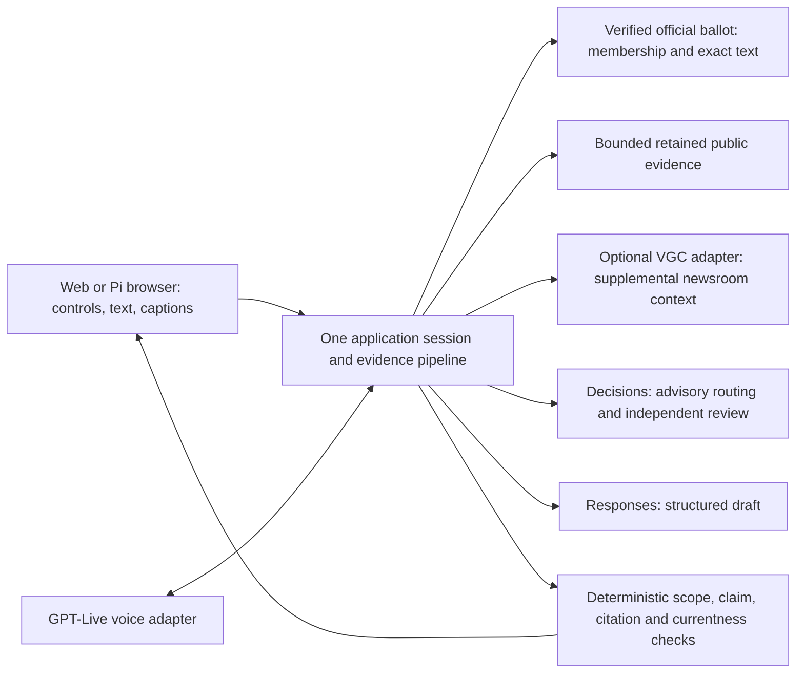

# OpenAI web rebuild decision — October 24, 2026

Status: initial architecture record; executable provider-off experiment. Follow-up consent fixes and authorized isolated API tests are in [the current checkpoint](CONSENT-AND-API-CHECKPOINT.md). Stable application unchanged. Parent remains project lead.

## What we learned and will keep

The Hack Midwest work established finite retained-source answers, exact source/hash/span contracts, scoped retrieval tools, cancellation/Erase protections, keyboard navigation and partial real OpenAI voice/review paths. The local October 11 technical post-mortem explicitly did not establish the complete human microphone → checked civic response → human-heard answer journey. Component passes and illustrated video were not end-to-end acceptance.

| Decision | Assets / evidence | Reason |
|---|---|---|
| Retain | `fixtures/official_combat.json`; original wording and provenance; `open_oracle/claim_bindings.py` concepts; source-role/scope checks | Ground explanations in exact retained evidence; hashes bind bytes, not current applicability. |
| Retain | Deliberate start, visible Stop/Erase, generation fencing, keyboard fallback and captions contracts | Prior lifecycle failures showed that cancellation and speech/display currentness need one owner. |
| Retain | Existing brand SVGs and locally licensed type; comprehension copy and demo lessons | No new visual identity or dependency-heavy generated UI is needed. |
| Replace | Strands/Bedrock/Titan requirement, AWS deployment/secret infrastructure and multiple provider orchestration layers in this experiment | One trusted server, bounded local evidence and OpenAI HTTP adapters are sufficient for this corpus. This is a new provider-off path, not AWS wrappers. |
| Reconsider | Automatic freeform generation for every answer, score-only review gates, continuous civic speech before checking | The old system already generated many answers from finite application-owned forms. Keep those as baseline; evaluate generative paraphrase against them, with explicit abstention. |
| Hold | Spanish civic text/speech, physical input, Pi runtime and continuous live voice claims | Spanish complete-display review was held; hardware tests and the full human journey remained incomplete. Existing catalogs are assets, not acceptance. |

Evidence supports an AWS access mismatch: required Secrets Manager permission was unavailable after packaging work. Bedrock Knowledge Base access was denied; a small local corpus did not need a vector service. Other failures were integration/acceptance failures (delegation timing, missing help routing, native browser timers, fragmented serving/deployment), not evidence that AWS caused every problem. No hardware RAM/model or current Pi readiness is assumed.

## Verified requested products

Official docs checked October 24, 2026, through OpenAI Developer Docs MCP:

- **GPT-Live**: `gpt-live-1`; `POST https://api.openai.com/v1/live/sessions`. Browser WebRTC transports audio; JSON data channel transports transcript/lifecycle events. HTTPS/localhost, explicit microphone permission and a server-side project key with Live access are required. The HTTP request starts the session: do not send `session.start`. [Getting started](https://developers.openai.com/api/docs/guides/live), [WebRTC](https://developers.openai.com/api/docs/guides/voice-webrtc#connect-a-browser-to-gpt-live).
- **Decisions API**: generally available, `POST https://api.openai.com/v1/decisions`, currently `gpt-6-luna` only. Typed predicate/choice/score results; not an explanation generator. `api.decisions.write` is required for native Live delegation. Refusals/missing/invalid results must hold; probabilities need application-specific calibration. [Decisions](https://developers.openai.com/api/docs/guides/decisions), [voice integration](https://developers.openai.com/api/docs/guides/decisions-voice). The reference-page fetch returned 404 through MCP; the full official guide supplied the endpoint and schema.
- **Responses API**: `POST https://api.openai.com/v1/responses`, strict Structured Outputs for draft explanation/claim IDs, never application-owned membership. Evaluate `gpt-6.1-sol` versus `gpt-6-luna` after explicit budget/access approval. `api.responses.write` is required. [Structured Outputs](https://developers.openai.com/api/docs/guides/structured-outputs).

Docs establish products and requirements, not this account’s entitlement. No credential was inspected; no model-list, inference, Decisions, Live or MCP query request was sent. No alpha header is needed for Decisions per the current voice integration guide. GPT-Live project access/rate limits remain unverified. The requested stack is retained in the proposed target; the runnable slice uses labeled local fixtures, with provider adapters disabled.

## Simpler target architecture

Official personalized election ballots establish **membership**. Public sample ballots establish only sample content. Newsroom coverage cannot add contests or candidates to a personal ballot; candidate statements remain attributed claims and newsroom reporting is labeled supplemental reporting. Missing, conflicting, stale or unverified scope produces a visible hold. No election URLs or citations are generated by a model.

Text: resolve explicit scope/intent → retrieve bounded passages → select reviewed forms or request structured draft → validate every claim against admitted evidence and exact original offsets/hash/version → independent review when live generation is enabled → publish one accepted immutable answer. Unknown claim IDs, omitted conditions, new numbers, absent sources and review failures hold. Strict JSON is syntax, not factual proof; a model score is never authority. Start without embeddings, remote search, hosted storage, agent swarms or generated UI.

Voice: keep explicit Start/Stop, actual-speech captions, manual Play and playback release gates. Prefer client delegation initially to retain source/currentness control; native Decisions delegation can later classify help/navigation/unsupported requests with `none`/unknown choices. All membership/advice/release rules remain deterministic. A model’s choice is not deterministic routing. Transcript deltas may be partial/out of order; never execute civic requests from an unfinished fragment. Separate listening, backend work, generated audio, accepted audio and actual playback. Interruptions invalidate pending results/audio by session revision. Stop/Erase immediately releases hardware/local state; provider graceful close/usage collection happens separately, bounded, and may remain unconfirmed.

**Consequential tradeoff for parent:** continuous GPT-Live speech cannot guarantee prechecked civic claims merely by holding backend text. Preserve buffered/manual civic playback until a controllable audio path is validated; this adds latency and limits natural full-duplex conversation. Live may support non-civic greetings, while substantive explanation follows the checked pipeline. Do not silently relax the release gate for conversational smoothness. [Migration guardrails](https://developers.openai.com/api/docs/guides/live-migration#adapt-your-guardrails).

## Voter Guide Commons adapter

[Connect](https://voterguidecommons.org/connect) documents no-auth Streamable HTTP at `https://voterguidecommons.org/mcp`, covering WI/MI/GA/CA/HI; **no Missouri coverage**. The experiment enforces that coverage guard locally and does not call the server. Only explicit public state/office/district/candidate IDs may reach a future adapter. Never expose `find_my_races` (address geocoding), raw visitor questions, DOB/address/private voter records or conversation history to models/MCP. No broad remote MCP delegation or automatic web fallback.

[Privacy](https://voterguidecommons.org/privacy) says tool parameters/search text are logged (up to 200 characters), lookup records persist about three months, and aggregate search terms can persist indefinitely. Its no-address-recording statement does not make transmitting an address acceptable for OpenOracle. [Publisher terms](https://voterguidecommons.org/publishers) retain newsroom ownership, opt-in agreement and withdrawal. [Answer rules](https://voterguidecommons.org/how-answers-work) require attribution, exact quotations, specific returned links, coverage notes, even-handed treatment and provenance distinction. These are not a blanket redistribution/training/cache license. Do not bulk mirror guides or publish cached text; verify specific publisher reuse permissions before retaining/reusing content. Optional supplemental context may abstain independently of the official answer. No model-produced link or newsroom claim becomes official ballot truth.

## Privacy, access, cost, latency and Pi

The slice has no visitor persistence, telemetry, cookies, account collection or external calls; typed visitor text remains in browser memory. Never request DOB/address. Reset clears the interface and invalidates delayed work, not secure RAM wiping or provider deletion. Live audio could itself contain private voter information: do not enable unrestricted microphone/cloud capture under the present restriction; parent must resolve a practical capture/redaction policy first. Input regexes cannot guarantee removal from raw streaming audio. [OpenAI data controls](https://developers.openai.com/api/docs/guides/your-data) distinguish abuse logs, application storage, ZDR eligibility and third-party MCP policies; `store:false` is not a universal zero-retention promise. Debug/tracing off.

[Pricing](https://developers.openai.com/api/docs/pricing): GPT-Live is $0.05/minute, per second; WebRTC initialization charges 15s credited against running duration. Decisions uncached input is $0.10/M tokens with no output charge. A 3-minute Live session is roughly $0.15 plus backend/tools; four 4k-token Decisions requests are roughly $0.0016, excluding cache/regional modifiers. Responses cost = input tokens × selected input rate + output tokens × output rate, plus any cache/tool charges; use the current Standard table before approval. These are estimates, not invoices. Reserve a shared hard cap, no automatic retries, max session duration, timeout/close watchdog and aggregate usage reconciliation before any live trial. Historical event budgets are not permission for new spend.

Latency target (not measured): local retained result <100ms; cancellable typed live result useful within 5s; voice interruption stops local playback promptly (<200ms target). Measure startup, complete-input, evidence, generation, review, audio-ready and human-heard separately; report p50/p95, holds and failures. A 7.746s old Play-ready receipt was not human-heard latency. No performance guarantees or conversion of test counts into accuracy.

Pi: same small browser client; cloud inference remains remote. One lightweight server, no vector DB/local LLM/GPU/3D orb/camera dependency. Bound corpus/request/concurrency/audio buffers; perform PDF/OCR/research ingestion off-device. No offline live inference claim; retained sources remain readable offline. Exact Pi model/RAM, browser audio APIs, CPU/thermal behavior, display magnification and physical button mappings must be measured later. No SSH, install, system change or device capture in this task.

## Bounded execution and acceptance

1. Preserve original dirty checkout; branch from verified remote main. Record reused hashes and discovered constraints. Keep experiment isolated under `experimental/openai-web`; stable routes untouched.
2. Deliver a public-source COMBAT reading slice with exact original, predefined grounded Yes/No/rate explanation, visible source/date/uncertainty, no personal membership claim, keyboard/button-ready input and idle reset. Reject synthetic injected membership records, including records claiming to be verified; no personalized-ballot importer exists yet. Show all provider/review/voice states honestly.
3. Test tampered/forged citations, source-role/scope/hash mismatches, no membership inference, advice refusal, unsupported questions, source prompt injection, offline adapter coverage, reset/late results, keyboard/reflow and disabled external routes. No paid calls.
4. After parent approves the architecture/capture policy and explicitly authorizes bounded spend/access: connect actual adapters, replay held/refusal/cancellation cases, compare structured generation with finite baseline, obtain bilingual review, then prove one complete supervised human journey on Mac before Pi. Commit/PR each coherent tested milestone. No public deployment or Pi changes.

## Skill availability

Read the available OpenAI Docs skill and codebase-design/frontend-design guidance. An exact `software-engineering` skill package was unavailable after local skill/path discovery; no claim of reading it. This did not prevent the bounded implementation using repository engineering contracts.
